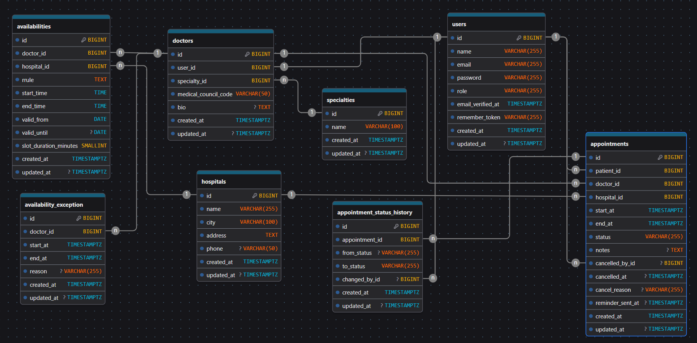

# Medical Appointment Booking API

A REST API for booking doctor appointments, built with **Laravel** and **PostgreSQL**.
There is no frontend: everything is available through the API (documented in the Postman collection).

## Features

- **Patient:** list doctors, see free slots, book / list / view / cancel appointments, read notifications.
- **Doctor:** manage own profile, define recurring working hours (RRULE) per hospital, add leaves, see own appointments, mark them `completed` / `no_show`.
- **Admin:** manage doctors, users, specialties and hospitals, see all appointments, view system reports.
- Notifications (database + mail), appointment reminders, and a status history for every appointment.

## Setup

```bash
composer install
cp .env.example .env
php artisan key:generate
```

Edit `.env`: set the `DB_*` values for a PostgreSQL database, then make sure these are set:

```
QUEUE_CONNECTION=database
MAIL_MAILER=log
```

```bash
php artisan migrate --seed
php artisan serve
```

Run these in two more terminals (needed for notifications and reminders):

```bash
php artisan queue:work
php artisan schedule:work
```

- Default admin: `admin@example.com` / `adminPassword123`.
- Timezone: the app uses `Asia/Tehran` (see `config/app.php`).
- Use `Authorization: Bearer <token>` (except register and login).

## Formats

| Type | Format | Example |
|---|---|---|
| Date | `Y-m-d` | `2026-11-05` |
| Time of day | `H:i` | `09:00` |
| Date and time | `Y-m-d H:i:s` | `2026-11-05 09:00:00` |

Lists are paginated (15 per page). Errors are always JSON with a `message` (`401`, `403`, `404`, `409`, `422`).

## Design decisions

**Users and roles**
- One `users` table with a role enum (`admin`, `doctor`, `patient`) and a separate `doctors` table for doctor data (medical council code, specialty, bio).
- Public registration always creates a patient. Admins create doctors (user + doctor profile in one database transaction).
- Users and doctors use **soft deletes**. Deleting a doctor also deletes the user account and revokes its tokens. A doctor or patient with upcoming booked appointments cannot be deleted (`409`). Email and medical code of deleted accounts stay reserved.

**Availability and slots**
- A doctor defines recurring weekly rules per hospital: days, interval (every N weeks), working hours, validity dates and slot duration. The API receives `days` and `interval` and builds the RRULE (`FREQ=WEEKLY;INTERVAL=n;BYDAY=...;WKST=SA`) on the server.
- Slots are not stored. They are generated on request from now until 30 days ahead, from the rules, minus leaves and non-cancelled appointments. Past slots are skipped. A doctor can work in several hospitals (optional `hospital_id` filter).

**Booking**
- Appointments are confirmed immediately (booked); there is no approval step. Statuses: `booked`, `completed`, `cancelled`, `no_show`.
- Booking runs in a transaction that locks the doctor row, then checks that the requested time is one of the generated free slots. If not, the API answers `409`. This prevents double booking.
- Cancelling: the patient, the doctor of the appointment, or an admin, only while the appointment is `booked` and in the future. Doctors and admins can set `completed` or `no_show` only after the appointment has started.

**Events, queue and scheduler**
- `AppointmentBooked` / `AppointmentCancelled` events are dispatched after the appointment is saved. Queued listeners send notifications (database + mail). A cancellation notifies the other person, not the person who cancelled.
- An observer writes a row to `appointment_status_histories` when an appointment is created and every time its status changes.
- The scheduler runs every 15 minutes, finds booked appointments starting within 24 hours that have no reminder yet, and dispatches a `SendAppointmentReminder` job. The job sends the notification and sets `reminder_sent_at`, so a reminder is sent only once.

## Database Diagram




